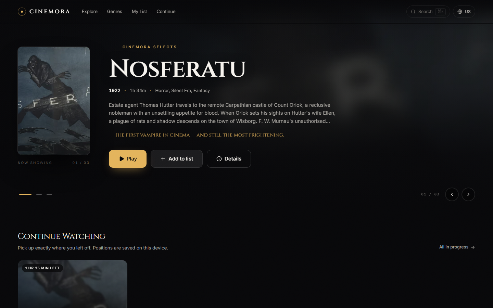
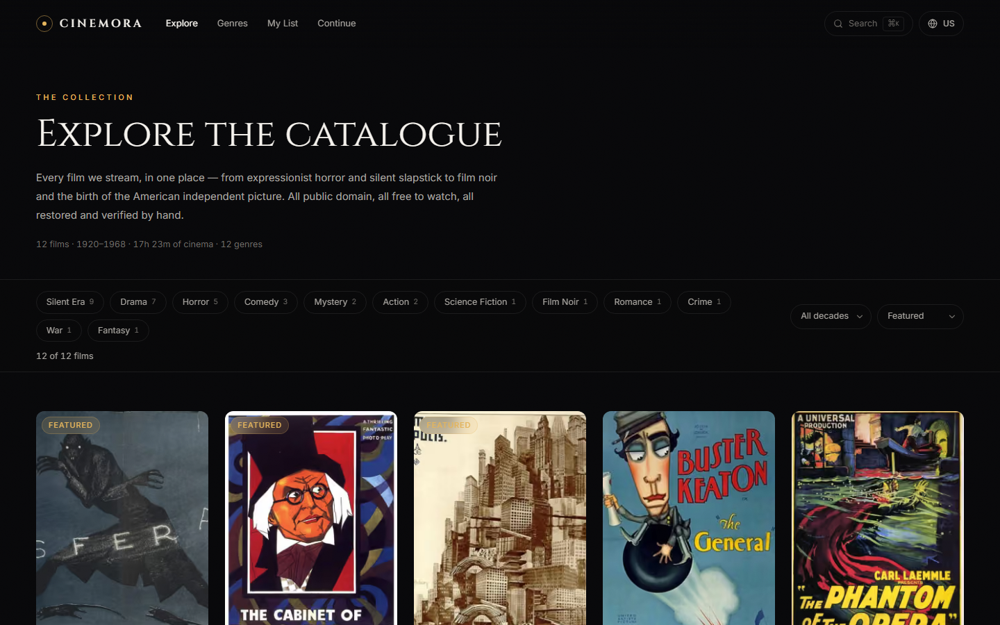
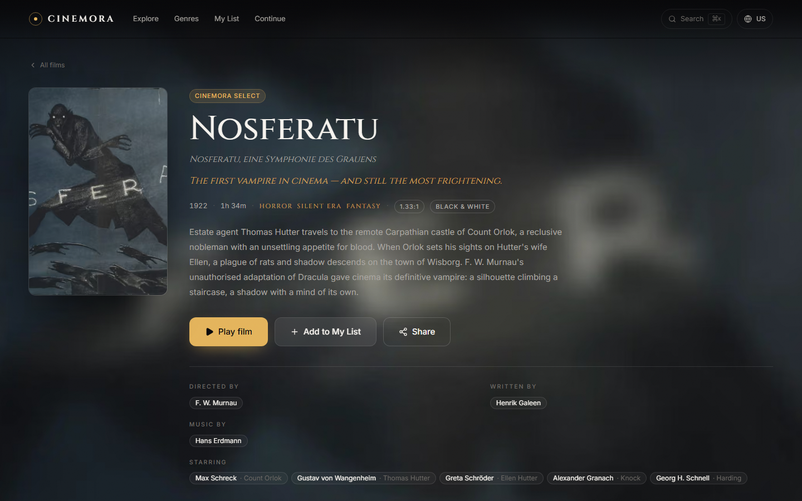
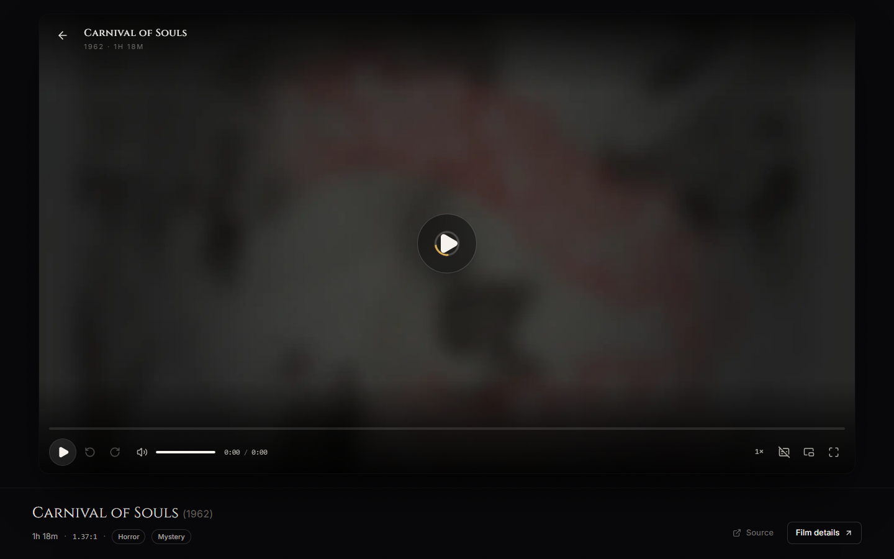
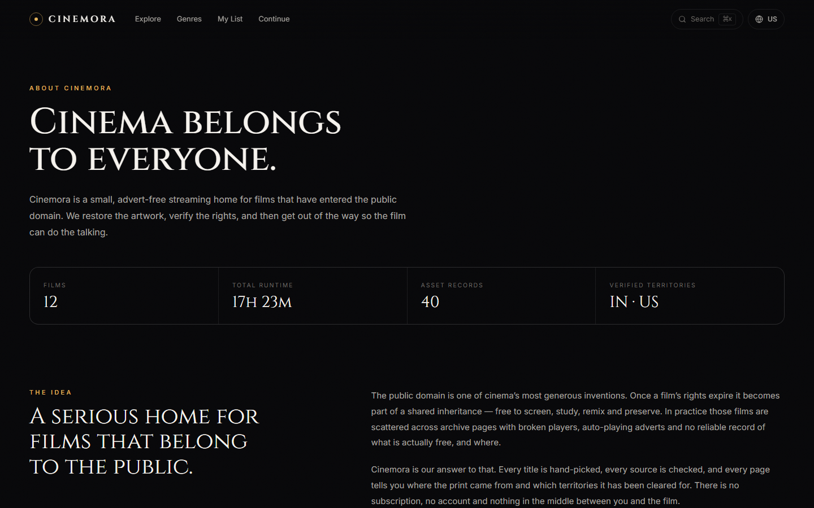
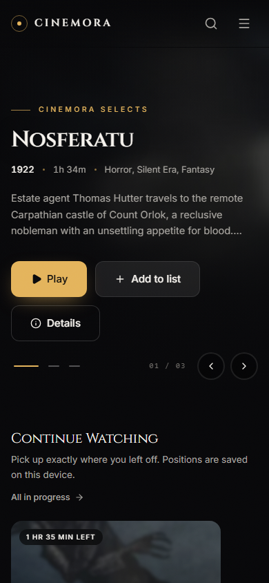
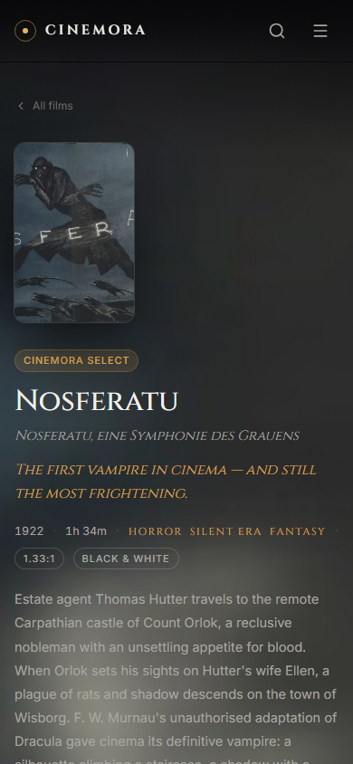

# CINEMORA

**Cinema, curated.** A premium, advert-free streaming home for films in the public domain —
built as a real product: editorial catalogue, bespoke artwork pipeline, and a hand-built video
player with frame-accurate keyboard control.

No accounts. No trackers. No advertising. Every title is free to watch, legally, forever.



---

## Quick start

```bash
npm install
npm run dev          # http://localhost:3100
```

Production:

```bash
npm run build
npm start            # http://localhost:3100
```

Quality gates:

```bash
npm run typecheck    # tsc --noEmit
npm run catalogue    # re-validate streams + rebuild artwork and data
```

Requirements: **Node 20.9+** and, for the content pipeline, **Python 3.10+ with Pillow**.

---

## What is in the box

| Area | Implementation |
| --- | --- |
| Framework | Next.js 16 (App Router, Turbopack) + React 19 |
| Language | TypeScript (strict) |
| Styling | Tailwind CSS v4 with CSS-variable design tokens |
| Data | Static catalogue JSON generated by a Python pipeline |
| State | `localStorage` behind `useSyncExternalStore` stores |
| Video | Native `<video>` + fully custom, accessible controls |
| Artwork | Posters and backdrops generated locally with Pillow |

Routes:

| Route | Purpose |
| --- | --- |
| `/` | Hero billboard, editorial genre rails, continue watching |
| `/explore` | Filterable catalogue (genre, decade, sort) with shareable URLs |
| `/genres/[slug]` | Curated genre landing pages |
| `/movie/[slug]` | Detail page, credits, rights record, related films |
| `/watch/[slug]` | Immersive player with resume, captions and keyboard shortcuts |
| `/search` | Debounced search over titles, people, genres and years |
| `/my-list` | Watchlist |
| `/continue` | Resume history, in progress and finished |
| `/about` | Mission, rights model, per-film attribution table |

Keyboard: `⌘K` / `Ctrl+K` or `/` opens the command palette anywhere in the catalogue.

---

## Screens

| | |
| --- | --- |
|  **Explore** — genre, decade and sort filters that stay in the URL |  **Film detail** — credits, rights record, related films |
|  **Player** — custom controls, resume, captions, shortcuts |  **About & rights** — the per-asset attribution table |
|  **Mobile home** |  **Mobile detail** |

> Screenshots were captured from the production build (`next build && next start`) with a headless
> Chromium over CDP at 1440×900 and 390×844.

---

## The content pipeline

`data/sources.json` is the hand-curated source of truth — titles, credits, synopses, genres,
the archive.org item and file, the Wikimedia poster file, and the licensed territories.

```bash
npm run catalogue                 # every film
python scripts/build_catalogue.py --only=nosferatu-1922
python scripts/build_catalogue.py --backdrops   # regenerate backdrops from local posters
```

The pipeline will refuse to publish a film unless:

1. the video URL answers `HTTP 206 Partial Content` with a `video/*` content type
   (required for seeking), and
2. its poster resolves through the MediaWiki API with an explicit licence, and
3. the poster downloads successfully with a real `User-Agent`.

It then crops artwork to a consistent 2:3 poster (landscape one-sheets crop toward the subject),
derives an auto-exposed, vignetted 16:9 backdrop, generates a base64 blur placeholder, converts
any archive subtitle track to WebVTT, and writes `data/movies.json`.

**Adding a film:** append an entry to `data/sources.json`, then run
`npm run catalogue`. Nothing else. The catalogue, sitemap, genre pages, search index and
related-film logic all derive from that file.

---

## The rights model

Playback and display permission are **derived, never stored** (`src/lib/rights.ts`):

- `canPlay(movie, territory)` — the video asset must be verified for the viewer's territory, and
  if the film ships subtitles at least one subtitle asset must be verified too.
- `canDisplay(movie, territory)` — poster and backdrop must be verified for public display.

An empty `verifiedTerritories` array means *unknown*, never *worldwide*. Region is detected from
the browser locale/timezone and can be changed from the header; this is a UX convenience, not
legal enforcement — see `/about#region`. Every film page carries its per-asset rights record and
a link back to the source.

Streams are served directly by the Internet Archive; artwork originates from Wikimedia Commons /
Wikipedia and is regenerated locally at build time. Nothing is re-hosted.

---

## Project layout

Two clearly separated trees: **the application** (everything the site needs) and **`docs/`**
(specification, screenshots, and the research record).

```
├─ src/                 # the application
│  ├─ app/
│  │  ├─ (main)/        # catalogue shell: header + footer + routes
│  │  ├─ (player)/watch # immersive, chrome-free player route
│  │  ├─ api/subtitles  # same-origin WebVTT proxy (archive.org sends no CORS headers)
│  │  ├─ layout.tsx     # fonts, metadata, toasts, film grain
│  │  └─ not-found.tsx  error.tsx  sitemap.ts  robots.ts
│  ├─ components/
│  │  ├─ ui/            # Button, Badge, Dialog/Sheet, Dropdown, Input, Skeleton, Toast
│  │  ├─ layout/        # Header, MobileNav, CommandPalette, RegionSelector, Footer
│  │  ├─ movie/         # PosterCard, Hero, MovieRow, ContinueRow
│  │  ├─ player/        # Player + controls
│  │  └─ catalogue/     # Explore filters, grids, detail-page parts
│  ├─ lib/              # catalogue, rights, search, stores, territory, utils
│  ├─ hooks/            # useWatchlist, useProgress, useTerritory, useMediaQuery
│  └─ types/            # shared domain types
├─ data/
│  ├─ sources.json      # hand-curated catalogue input
│  └─ movies.json       # generated runtime catalogue
├─ scripts/build_catalogue.py
├─ public/posters|backdrops|subtitles
└─ docs/                # never imported by the app
   ├─ SPEC.md           # product & design specification
   ├─ screenshots/
   └─ analysis/         # research record for the third-party app that informed the design
```

### About `docs/analysis/`

Before building CINEMORA we statically analysed a popular free-streaming Android app
(React Native + WebView) to understand how these products are put together. The write-ups and
helper scripts are committed; the 160 MB of APK binaries and extracted trees are **not** — they
are git-ignored and stay on the local machine. Start at
[`docs/analysis/README.md`](docs/analysis/README.md).

That research is **not** part of the product: CINEMORA streams public-domain films from the
Internet Archive and imports nothing from the analysed app.

---

## Deploying

Vercel (free tier) is a zero-configuration target:

```bash
npx vercel        # preview
npx vercel --prod # production
```

The site is fully static apart from the subtitles proxy route. There is no database, no
environment variable and no secret to configure. Set the canonical domain in
`src/lib/constants.ts` (`SITE.url`) so metadata, sitemap and robots point at the right host.

---

## Known limitations

- Video is streamed from archive.org. Playback speed depends on that host; the player exposes a
  secondary source per film where the archive item offers one.
- Territory gating is client-side. It keeps the UI honest; it is not DRM.
- Captions exist only where the archive item ships a subtitle track.
- `localStorage` is the only persistence layer, so watchlists and progress do not sync across
  devices or survive clearing site data.

---

## Credits

Film catalogue: public-domain works, streamed from the [Internet Archive](https://archive.org).
Poster artwork: Wikimedia Commons and Wikipedia contributors, regenerated locally.
Built with Next.js, React, Tailwind CSS and Lucide.
